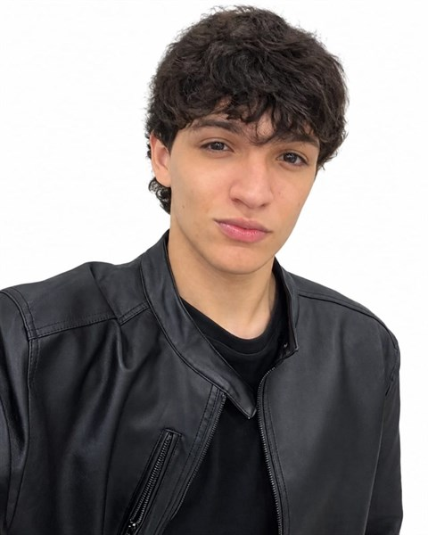

<table>
  <tr>
    <td width="230" valign="top">
      
    </td>
    <td valign="top">
      <h1>Gabriel Kaique Correia da Luz</h1>
      
<strong>Desenvolvedor de Software em formação</strong> — Curso Técnico em Análise e Desenvolvimento de Sistemas (SENAI), Ponta Grossa — PR.

      
Trabalho com <strong>Python</strong>, <strong>C++</strong> e <strong>desenvolvimento web</strong>, e uso <strong>Inteligência Artificial aplicada</strong> (integração com LLMs via API e engenharia de prompt) como ferramenta no meu fluxo de desenvolvimento.

      

        
        
      

      
<a href="https://kaka198977.github.io/portifolio/"><strong>Conheça meu portfólio completo</strong></a>

    </td>
  </tr>
</table>

---

## Tecnologias

---

## Projeto em destaque

### Sistema de Monitoramento e Manutenção Preditiva Industrial com IA (TCC)

Software em Python para centralizar e monitorar equipamentos industriais em tempo real a partir de
dados simulados: relatórios de desgaste, gráficos de análise preditiva para prevenção de falhas e
integração com LLMs de IA generativa via API para traduzir métricas técnicas complexas em relatórios
claros para o operador. Inclui o planejamento de uma visualização 3D por camadas para localizar
anomalias estruturais.

`Python 3` · `APIs de IA (LLM)` · `Análise de Dados` · `Visualização 3D`

### Site educativo — Parque Estadual de Vila Velha

Projeto interdisciplinar em equipe (Equipe Trupe — SENAI), publicado online. Fui responsável por
**toda a programação do site**, enquanto os demais integrantes cuidaram da pesquisa de conteúdo.

`HTML5` · `CSS3` · `Responsivo` · `Trabalho em equipe`

[Ver o site](https://celioxer.github.io/TDS_SESI/Interdisciplinar_Coop/site-vila-velha/index.html)

---

## Sobre mim

- Curso Técnico em Análise e Desenvolvimento de Sistemas — **SENAI** (conclusão prevista: 2026)
- Atuo como **Assistente de Registro e Digitalização** no 2.º Registro de Imóveis de Ponta Grossa
- Desenvolvo landing pages responsivas, sites institucionais e programas de estudo em Python e C++
- Buscando a primeira oportunidade como **Desenvolvedor Júnior**, **Estagiário** ou **Suporte Técnico**
  (presencial, híbrido ou remoto)

## Contato

